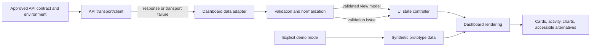

# ARC-09 Dashboard API Integration Blueprint

**Status: PROPOSED ONLY — NOT APPROVED / NOT IMPLEMENTED**

This blueprint describes a contract-neutral integration boundary for future planning. It does not define an API, endpoint, response schema, authentication method, approved frontend architecture, or production implementation. The repository audit found no authoritative first-party Dashboard Metrics API contract. Production integration has not started.

## 1. Current architecture findings

The target in scope is an isolated static prototype, not an identified production frontend:

- `arc09-ui-prototype/index.html:8, 10-75` links the stylesheet and defines the prototype shell, synthetic-data notice, startup alert/loading elements, and overview/resource containers; `:81-136` contains the chart, graph, activity, table alternatives, and static component-state preview.
- `arc09-ui-prototype/index.html:165-169` loads scripts in this order: `data.js`, `data-provider.js`, `charts.js`, `data-validation.js`, then `app.js`.
- `arc09-ui-prototype/data.js:1-51` supplies frozen synthetic overview, resource, trend, comparison, scatter, graph, and activity examples. It remains prototype-only and is not production data.
- `arc09-ui-prototype/data-provider.js:1-12` exposes `getData()` and currently returns the existing fixture object from `window.arc09PrototypeData`; the provider is synchronous and performs no I/O.
- `arc09-ui-prototype/data-validation.js:1-26` checks the prototype presentation-model shape and selected value types. It is not an authoritative backend DTO/schema validator and does not define production contract rules.
- `arc09-ui-prototype/app.js:264-285` obtains provider data with `await`, so startup accepts the current synchronous fixture result and Promise-returning providers. It validates data before any dashboard, chart, graph, table, or activity rendering.
- `arc09-ui-prototype/app.js:101-145, 287-328` handles startup failure cleanup and, after validation, renders metrics/resources, charts, graph, table alternatives, activity filtering, and the separate static state preview.
- `arc09-ui-prototype/charts.js:14-20, 43-66` creates SVG visualizations with titles/descriptions and keyboard-focusable tooltip marks; `:70-80` handles local chart empty/error states, not backend response handling.
- `arc09-ui-prototype/styles.css:842-844, 1123-1195, 1336-1342` contains visible focus styling, prototype responsive breakpoints, and reduced-motion handling.
- `data-validation.test.html`, `startup-rejection.test.html`, and `startup-invalid-data.test.html` are isolated test pages, not production application pages. They exercise the prototype validator or real startup path using test-page-only inputs.
- `arc09-ui-prototype/PROTOTYPE_HANDOFF.md:7-21, 27-39, 55-78` describes the prototype scope, synthetic data, verification boundaries, and production integration blockers.

No production API transport, backend integration, or authoritative response schema exists in this prototype. The current validator is limited to the prototype presentation model; a production adapter would require contract-specific parsing, validation, and mapping outside the synthetic fixture/provider behavior.

The prototype data keys and labels are examples only. They must not be reused as backend field names or scientific definitions. Its breakpoints are prototype choices, not approved production viewport requirements.

The backend handoff request leaves production repository/stack, service, contract, authentication, environment, CORS, error policy, and review requirements pending (docs/ARC09_BACKEND_DATA_CONTRACT_REQUEST.md:68-81, 96-109). The initial dashboard-summary slice is explicitly proposed pending approval (docs/ARC09_BACKEND_DATA_CONTRACT_REQUEST.md:12-23, 27-39).

## 2. Proposed integration boundary

Every interface below is **NOT APPROVED / NOT IMPLEMENTED** until the production target, stack, and authoritative contract are supplied.

| Boundary | Proposed responsibility | Contract-neutral constraint |
|---|---|---|
| API transport/client | Perform a request using only approved production configuration and contract. | No endpoint, method, headers, authentication, retry, timeout, or base URL is assumed here. Keep credentials out of source and browser bundles; use only the approved secure configuration pattern. |
| Dashboard data adapter | Translate the approved response into a presentation-oriented view model. | Keep API DTOs separate from UI fields. Do not infer meanings from prototype labels or silently map unknown fields. |
| Validation and normalization | Check response structure and declared field rules before rendering. | Preserve nullability, units, provenance, freshness, and uncertainty when supplied. Reject non-finite numeric values and malformed required data according to approved policy; never coerce invalid values into plausible chart values. |
| UI state controller | Coordinate loading, success, valid-empty, partial-data, and failure states. | Distinguish a valid empty result from request or validation failure. Show partial data only if the contract and product owner define allowable omissions and how they are communicated. |
| UI rendering | Render validated view models through metric/card/activity/chart components. | Keep API DTOs separate from UI fields. Rendering should not own transport or invent scientific formatting. Keep sample/demo data visibly separate from production data. |

### Data-flow proposal

This is a conceptual boundary only. It does not represent currently implemented modules or an approved production data flow. Production rendering must not silently fall back to synthetic sample data.

## 3. Contract-neutral behavior requirements

- **Failures:** Represent transport, server, authorization, and invalid-response failures distinctly only as far as the approved contract supports. Show a user-safe message and recovery action approved by product/backend owners; do not expose sensitive response details.
- **Missing and null values:** Treat an absent required field, an explicitly nullable field, and a valid empty response as different cases. Do not substitute zero, an empty string, or fabricated values unless the approved field contract explicitly defines that behavior.
- **Numeric values:** Reject malformed and non-finite values before charting. Apply ranges, precision, rounding, and aggregation only when the contract or domain owner documents them.
- **Timestamps:** Display or sort timestamps only after format, time zone, ordering, and freshness semantics are confirmed.
- **Units and scientific meaning:** Display labels, units, uncertainty, provenance, and measured/simulated/estimated status only from approved definitions. Do not infer units from a number or chart axis.
- **Partial data:** Define per-field optionality and whether partial results are usable before displaying them. Clearly identify unavailable values; do not imply the response is complete.
- **Demo separation:** Keep synthetic fixtures in an explicit demo/test path. Production mode must not use them as fallback content or label them as live data.
- **Accessibility:** Preserve semantic headings/regions, visible keyboard focus, keyboard-operable navigation and chart marks, accessible SVG title/description, status announcements, and existing table/text alternatives. State changes and errors must remain perceivable without relying on color alone.
- **Responsive behavior:** Retain accessible controls and content without clipping or unintended horizontal overflow at team-agreed test sizes. Existing prototype breakpoints are not production requirements.

## 4. Responsibilities and ownership boundaries

Ownership below reflects the coordination context supplied for this work; it is not evidence of approval or a confirmed assignment beyond that context.

- **ARC-09 / Hridi:** dashboard presentation, chart and table alternatives, accessibility/responsive behavior, and mapping an approved contract to UI needs. Do not implement ARC-10 services or invent scientific semantics.
- **ARC-10 / Sonjoy and Rafi:** provide or identify the authoritative service contract, implementation location, test environment, and backend-side behavior.
- **Amran:** confirm integration requirements, initial visualization scope, review needs, and acceptance criteria.
- **Yousuf:** confirm the production frontend target and architecture/integration approval process.
- **Relevant data/science/simulation owners:** confirm domain field meanings, units, provenance, uncertainty, and interpretation before ARC-09 displays those values.

## 5. Required backend and product decisions

Before implementation, obtain an authoritative, versioned contract or approved documentation location that confirms:

1. Production frontend repository, branch, stack, and integration target.
2. Whether dashboard metrics are in initial product scope and which content is approved.
3. Endpoint, HTTP method, request parameters, complete success/empty/error examples, and field definitions.
4. Types, required/nullable status, identifiers, units, scientific meanings, validation, and compatibility/versioning rules.
5. Authentication/authorization, CORS, environment configuration, secret handling, and client-safe errors.
6. Timestamp, time-zone, freshness, provenance, uncertainty, and value-origin semantics where applicable.
7. Loading, empty, partial-data, invalid-response, and failure behavior.
8. Test environment, verification instructions, responsible API owner, reviewer, and acceptance record.

These questions align with docs/ARC09_BACKEND_DATA_CONTRACT_REQUEST.md and docs/ARC09_DASHBOARD_API_INTEGRATION_REQUEST.md. The requests themselves do not constitute approval.

## 6. Testing and acceptance checklist

After the contract and target are approved, record expected and actual results for each applicable case:

- [ ] Valid successful response maps only documented fields to the UI.
- [ ] Valid empty response is distinguishable from an error.
- [ ] Partial response follows explicitly approved optionality and partial-data rules.
- [ ] Missing required fields are rejected or handled according to the contract.
- [ ] Invalid, malformed, or non-finite numeric values do not appear as valid chart data.
- [ ] Network/transport failure shows the approved failure state.
- [ ] Server error follows the documented error policy.
- [ ] Loading state appears during an actual pending request and is announced accessibly.
- [ ] Synthetic data is not presented as production data or used as an implicit production fallback.
- [ ] Units, timestamps, provenance, uncertainty, and scientific labels match approved definitions.
- [ ] Keyboard navigation, visible focus, chart tooltips, SVG descriptions, and table/text alternatives remain usable.
- [ ] At team-agreed viewport sizes, important controls/content remain accessible without unintended clipping or horizontal overflow.
- [ ] Tests use approved examples/fixtures and record cases not run; no scientific validity is inferred from UI tests.

## 7. Implementation phases after approval

1. Record approval of the production frontend target, stack, initial dashboard scope, and contract version.
2. Create a reviewed field-to-view mapping, including nullability, units, provenance, timestamps, and error/partial-data behavior.
3. Implement the transport/client and adapter in the approved production repository using its established patterns.
4. Add validation and explicit request states; keep demo fixtures isolated from production mode.
5. Connect only the approved dashboard slice and preserve accessible renderers/table alternatives.
6. Run contract-driven tests, keyboard/accessibility checks, and responsive checks at agreed sizes; record results.
7. Obtain backend/frontend review and record acceptance before expanding the integration.

## 8. Approval status

- **Production API contract:** NOT FOUND in the inspected request documents; no endpoint or schema is defined here.
- **Production frontend target and stack:** PENDING.
- **Architecture and proposed boundaries in this document:** NOT APPROVED / NOT IMPLEMENTED.
- **API calls or backend integration in the ARC-09 prototype:** NOT IMPLEMENTED.
- **Production readiness:** NOT ESTABLISHED.

No implementation should begin from this blueprint alone.

## 9. Authorization and approval boundary

The request accompanying this update states that Project Owner Yousuf authorized Hridi to prepare, implement, test, and document ARC-09 work within the stated approval boundaries. This is **user-provided authorization evidence**; the repository does not independently verify the sender's identity or contain a separate approval record for this statement.

That authorization permits ARC-09 preparation. It does not supply an API contract, choose the production frontend repository or branch, approve the proposed architecture, define scientific meanings, or replace ARC-10/backend review. Network integration remains gated on those project decisions. No speculative endpoint or request is authorized by this document.

## 10. Locally available cross-ARC interface evidence

The following are static observations from locally cached remote-tracking refs, not confirmation that those refs are current on the remote. No fetch was performed for this preparation. These reusable structures are not, by themselves, frontend contracts or cross-ARC product approvals.

| Workstream and cached ref | Available implementation/interface evidence | Relevance and boundary |
|---|---|---|
| ARC-03 data engineering — `origin/arc/03-data-engineering` (`8b8f21fc3ff42286cd6e4894ad25616c9df87354`) | `src/quantum_space_agi/data/models.py` defines generic `Dataset` records and JSON-compatible values; `src/quantum_space_agi/data/schemas.py` defines generic field presence/type validation; `src/quantum_space_agi/data/provenance.py` represents dataset identity, source, timezone-aware retrieval time, format, optional version, transformations, and metadata. | Useful concepts for provenance and declared validation. No dashboard DTO, HTTP serialization contract, production API, or ARC-09 field mapping is defined by these models. Do not reuse them as wire types without owner approval. |
| ARC-04 scientific computing — `origin/arc/04-scientific-computing` (`ac8c81fbbae5341d9b8c51baf1ad49eb103af262`) | Cached tree contains scientific notebooks and `docs/scientific/units_module.md`; no dashboard response schema or frontend interface was identified in that ref. | Scientific utilities or unit conventions require a specific approved field mapping before display. A library or notebook is not a metric definition. |
| ARC-05 simulation — `origin/arc/05-simulation` (`a7a440972a3dd469c0e954be78ce4474586cdaa5`) | `src/quantum_space_agi/simulation/models.py` defines strict simulation inputs including position/velocity, time, integrator and reference-frame declarations; `src/quantum_space_agi/simulation/workflow.py` returns times, states, collision diagnostics, and model metadata. | This is a scientific simulation interface, not a dashboard API or general mission summary contract. Its explicitly named SI/frame fields must not be generalized to unrelated dashboard values. No approved ARC-09 visualization mapping is recorded. |
| ARC-06 optimization — `origin/arc/06-classical-optimization` (`68f11188d14c411db1a00a323d3717a04478a479`) | `src/quantum_space_agi/optimization/models.py` defines generic finite-domain optimization problems and results, including status, optional solution/objective value, constraint checks, evaluated candidate count, and solver name. | Potential future source only if a product owner approves optimization views and owners define score/constraint semantics, units, provenance, and uncertainty. No dashboard contract is present. |
| ARC-07 quantum toolkit — `origin/arc/07-quantum-toolkit` (`19157592d389f7fbb41830379a38efc464680c94`) | Cached branch tree contains only the repository README at its initialization commit. | No locally cached ARC-07 implementation or product-facing output interface was found on that ref. Do not infer capability from the workstream name. |
| ARC-08 AI/ML — `origin/arc/08-ai-ml` (`e35c9d5fd7da5b0b91f07011db188253d202f42e`) | Includes dataset ingestion/provenance and the NASA Exoplanet Archive adapter (`src/quantum_space_agi/data/adapters/exoplanet_archive.py`); `docs/ARC08_ML_READINESS_DECISION.md` records a baseline ML NO-GO. | The adapter retrieves an external NASA archive dataset; it is not the project's first-party Dashboard API. The ML decision does not provide a production dashboard result schema. |
| ARC-10 API integration — `origin/arc/10-api-integration` (`19157592d389f7fbb41830379a38efc464680c94`) | Cached tree contains only `README.md` at the initialization commit. | No endpoint, API service, OpenAPI specification, DTO, auth/error contract, or frontend integration instructions are available in this cached ARC-10 ref. Confirm against the authoritative/current ARC-10 source when available. |

The ARC-09 source tree remains an isolated static prototype. Its source fields below are verified prototype implementation details only; they are not API field proposals or product requirements.

## 11. Visualization field-mapping readiness matrix

“Prototype fields” records what the existing synthetic example currently consumes. “Production mapping” remains blank by design until an authoritative contract is approved. All product/API mappings are **MISSING**; the proposed P0 scope is conditional and is not approval.

| Visualization | Existing prototype data shape (synthetic/conceptual only) | Production mapping status | Contract/domain decisions needed |
|---|---|---|---|
| Dashboard metric cards | `data.js`: `overview[]` items use `label`, `value`, `detail`, `icon`, `tone`; all are illustrative strings/statuses. | **MISSING** — no API field is confirmed. | Select summary metrics and stable context IDs; define value type/nullability, meaning, units or unitless status, formatting, provenance, update/freshness, and authorized empty/partial behavior. |
| Resource cards | `resources[]`: `label`, numeric `value`, `%` display `unit`, `detail`; current values are synthetic (68 and 42) and no total/limit is implied. | **MISSING** — no resource identifier, denominator, capacity, or API unit definition is confirmed. | Define each resource and its denominator/reference, unit, limits if applicable, nullability, precision, provenance, freshness, and whether a percentage is meaningful. |
| Recent activity | `activity[]`: `title`, `action`, `status`, `time`; `time` is a sample-entry label rather than a timestamp. | **MISSING** — no event schema is confirmed. | Define event identity, event/action/status semantics, allowed status values, timestamp/time zone/order, actor visibility, pagination/filtering, retention, and nullability. |
| Line chart | `trend[]`: numeric `step` and `value`, synthetic unitless sample sequence. | **MISSING** — neither axis is a production field. | Define series, x-axis meaning and ordering, y-value meaning/unit, sample/aggregation method, gaps/nulls, uncertainty, provenance, and valid range. |
| Grouped bar chart | `comparison[]`: `category`, numeric `seriesA`, numeric `seriesB`, synthetic unitless examples. | **MISSING** — categories and series have no product meaning. | Approve categories/series, units and comparability, aggregation, ordering, nullability, uncertainty, and provenance. |
| Scatter chart | `scatter[]`: numeric `x`/`y` pairs, synthetic and unitless. | **MISSING** — no production axis or relationship is established. | Define both axes/units, paired-observation identity, filtering, coordinate conventions if relevant, uncertainty, missingness, and provenance. Do not infer correlation or causality from the demo. |
| Relationship graph | `relationshipGraph` has conceptual nodes with `id`/`label` and edges with `from`/`to`/`label`. | **MISSING / SCOPE UNCONFIRMED** — graph is illustrative, not a domain model. | Product owner must confirm scope; domain owners must define entity IDs/types and edge meaning, direction/cardinality, permissions, size/pagination, and provenance. |

The existing field names above are only source-level facts from `arc09-ui-prototype/data.js`; none are endorsed as backend names. Until contract review, no visualization can consume production data without inventing a mapping.

## 12. Proposed P0 implementation sequence (approval-gated)

The smallest useful production slice is the proposed dashboard summary feeding the metric-card area, as already requested in `docs/ARC09_BACKEND_DATA_CONTRACT_REQUEST.md`. It is a planning target, not approved product scope. Do not start network integration in the isolated prototype merely because it is the available UI.

1. **Confirm target and gate:** Yousuf/architecture owner confirms the production frontend repository, branch, stack, and architecture path; Amran confirms the initial visualization scope and review/acceptance criteria.
2. **Obtain authoritative contract:** ARC-10/API owner and backend owner identify the versioned summary contract, complete representative success/empty/error examples, field definitions, validation, authentication, CORS, environment configuration, and test environment. Data/science owners define units, meaning, provenance, freshness, and uncertainty where applicable.
3. **Approve one field mapping:** Hridi and the relevant owners map only documented fields to metric-card view-model needs. Record nullability, formatting, provenance display, freshness, partial-data rules, and error presentation. Reject unmapped fields rather than guessing.
4. **Implement in the approved frontend:** use its established client/transport and configuration patterns. Keep transport, response DTO, validation, adapter/view model, state controller, and renderer separate. Keep credentials out of browser source and bundles; use only the platform-approved auth/configuration boundary.
5. **Add explicit states:** loading, valid empty, success, and failure; add partial-data handling only if its contract and product behavior are approved. Never fall back to synthetic demo values in production mode.
6. **Verify the slice:** unit tests for parser/adapter/state mapping, mocked transport tests for network/status cases, contract tests against approved examples, and approved test-environment verification. Record accessibility, responsive, and reviewer results.
7. **Review before expansion:** obtain backend/API and frontend review and record acceptance. Expand to resources/activity/charts only after each domain mapping and product scope is separately approved.

**Implementation gate:** production frontend target and architecture approval + authoritative versioned API contract + approved P0 scope and scientific definitions + test/auth/configuration instructions. Until these are available, the authorized ARC-09 work is preparation and contract-neutral UI planning, not speculative API calls.

## 13. Required decisions, owners, and evidence

The roles and owner names below reflect the user-supplied coordination context for this task. They are not independently verified against external identity systems. Where a specific backend owner is not identified in repository evidence, that role remains unassigned here.

| Decision/evidence | Responsible party per supplied context | Required record before production implementation |
|---|---|---|
| Project authorization and architecture boundary | Yousuf (Project Owner) | User supplied authorization is recorded above; confirm the production target, approved architecture, and any architecture review/approval record. |
| Production API architecture and integration contract | ARC-10 owners Sonjoy and Rafi | Authoritative repository/branch and versioned contract location; transport/auth/configuration/error/test conventions. |
| Endpoint, method, schemas, examples, and service behavior | Backend owner (name not identified) | Endpoint details only from the authoritative service spec; complete success, empty, and error examples with types/nullability and versioning. |
| Initial scope, integration requirements, and review criteria | Amran and Rafi per supplied context | Written P0 scope, intended user behavior, required states, acceptance criteria, and review record. |
| Scientific/data semantics | Relevant ARC/data/science owners; specific owner not established here | Approved field meanings, units, provenance, freshness, uncertainty, and value origin for fields selected for UI. |
| ARC-09 presentation and implementation | Hridi | Contract-to-view mapping, accessible UI states/rendering, tests in the approved production target, and implementation notes. |

Repository-only evidence still shows the backend contract request as a request, the ARC-10 cached branch as an initialization README, and no corresponding owner response in the inspected ARC-09 records. This does not establish that no decision exists elsewhere; it means the required authoritative record is not available in the inspected repository state.

## 14. P0 testing and acceptance checklist

Run these checks only after the target, contract, and test instructions are approved. Use contract-approved fixtures; do not create domain examples by guessing.

- [ ] API client uses approved base-URL configuration and authentication boundary; no secret is committed or exposed to browser code.
- [ ] Parser accepts the authoritative success example and rejects malformed structure without coercion.
- [ ] Adapter maps only documented DTO fields; units, nullability, provenance, freshness, and uncertainty are preserved or displayed per approved rules.
- [ ] Loading, success, valid-empty, and transport/server/auth/validation failure states match the agreed behavior; partial response tested only if policy exists.
- [ ] Unauthorized and forbidden behavior is tested according to the approved auth/error contract without exposing response internals.
- [ ] Network unavailable, timeout/cancellation, server failure, malformed JSON/schema, missing required values, explicit nulls, and non-finite numbers are covered where representable by the agreed contract.
- [ ] Demo fixtures remain isolated; production mode never silently presents synthetic data as live data.
- [ ] Component tests verify state changes and value formatting against approved examples; request tests do not depend on NASA Archive or other external services.
- [ ] Integration verification runs only against the designated non-production environment using approved credentials/configuration, and records environment and contract version without secrets.
- [ ] Keyboard and assistive-technology review covers status announcements, error discoverability, focus behavior, chart alternatives, table/text alternatives, and non-color cues.
- [ ] Responsive checks use owner-approved viewport sizes; record clipping/overflow and loading/empty/error behavior at those sizes.
- [ ] Regression checks preserve current chart descriptions, accessible alternatives, semantic structure, visible focus, and reduced-motion/responsive behavior appropriate to the approved frontend.
- [ ] Reviewer records pass/fail/not-run per acceptance criterion; formal acceptance is captured in the team-designated record before scope expansion or release.

**Current state:** These are future checks, not test results. No production API client or integration has been implemented or exercised by this document update.

## API Integration Test Matrix — Pending Contract Approval

This matrix defines future test preparation, not test results or an approved API contract. Statuses describe readiness only. No endpoint, HTTP method, response field, error schema, authentication mechanism, or production target is assumed.

| Test ID | Scenario | Preconditions | Test action | Expected behavior | Required contract decision | Status |
|---|---|---|---|---|---|---|
| API-01 | API connectivity and unavailable service | An approved non-production target and safe connectivity test procedure are available. | Verify connectivity, then use an approved method to simulate an unavailable service. | Connection outcome is shown accurately; unavailable service produces an explicit error state and never silently falls back to synthetic demo data. | Target, transport behavior, unavailable-service handling, and recovery guidance. | BLOCKED |
| API-02 | Successful response | Approved contract and representative success fixture are available. | Provide the approved success example to the parser and adapter. | Only documented values are validated and mapped; meanings, units, and provenance are preserved. | Response structure, field definitions, nullability, validation, and mapping. | READY AFTER CONTRACT APPROVAL |
| API-03 | Valid empty response | Contract defines how a valid empty result is represented. | Provide the approved empty example. | Empty state is distinguishable from success with content and from request or validation failure. | Valid-empty representation and user-facing empty behavior. | READY AFTER CONTRACT APPROVAL |
| API-04 | Missing or nullable fields | Contract identifies required, optional, and nullable fields and any partial-data policy. | Test approved fixtures with a required field absent, an optional field absent, and a nullable field explicitly null. | Required omissions follow validation failure behavior; optional/null values follow documented policy and are not silently replaced with plausible values. | Requiredness, nullability, partial-result rules, and display behavior. | BLOCKED |
| API-05 | Invalid response structure and data types | Approved structural and type rules are documented. | Supply malformed structure and values of incorrect types using isolated test fixtures. | Invalid data is rejected or reported according to the contract; implementation does not silently coerce invalid values. | Structure, types, validation rules, and client handling for invalid responses. | READY AFTER CONTRACT APPROVAL |
| API-06 | HTTP error categories | Approved target or fixtures can represent the error categories relevant to the contract. | Exercise applicable request/client, access, service, and upstream failure categories without assuming specific status codes or a common error body. | Each applicable category yields the documented user-safe state; unknown details are not fabricated. | Applicable status categories, error representation, and retry/recovery policy. | BLOCKED |
| API-07 | Authentication and authorization failures | Security owner has approved a test environment and non-production test credentials or equivalent safe test setup. | Exercise applicable unauthenticated and unauthorized cases without exposing credentials. | Access failures are distinguished and handled as documented; secrets and sensitive response details are not exposed. | Authentication and authorization model, failure behavior, and safe test procedure. | BLOCKED |
| API-08 | Timeout and network interruption | Approved timeout/cancellation behavior and a controlled test method are available. | Simulate a timeout and an interrupted connection. | Pending work ends or recovers according to policy, the user receives a clear status, and stale or synthetic values are not shown as current. | Timeout, cancellation, retry, and interruption semantics. | BLOCKED |
| API-09 | Loading, success, empty, and error UI states | Approved frontend target and state behavior are defined; fixtures cover success, valid empty, and failure. | Exercise each state through the real request lifecycle or an approved test seam. | Each state is distinguishable, accessible, and consistent with the response outcome; partial-data state is used only if separately defined. | State transitions, partial-data applicability, announcements, and recovery behavior. | BLOCKED |
| API-10 | Data freshness and provenance display | Contract defines freshness, timestamp meaning/time zone, source, and provenance for applicable values. | Render approved examples containing those definitions and inspect display and ordering. | Only supplied and defined provenance/freshness information is shown; timestamps are not inferred or relabeled. | Provenance fields, timestamp semantics, time zone, freshness meaning, and display rules. | BLOCKED |
| API-11 | Numeric precision, units, and scientific metadata | Relevant domain owners and contract define quantity meaning, units, precision, uncertainty, and value origin for selected data. | Render approved numeric examples, including documented boundary/null cases. | Values are not reinterpreted; labels, precision, units, uncertainty, and measured/simulated/estimated status follow approved definitions. | Field semantics, units/reference frame if applicable, precision, uncertainty, nullability, and provenance. | BLOCKED |
| API-12 | Large datasets and pagination, if applicable | Contract confirms whether large results or pagination apply and defines relevant limits and ordering. | Exercise approved boundary-size and paginated fixtures, if applicable. | Client respects documented limits and ordering without dropping, duplicating, or misrepresenting records; otherwise record as not applicable per contract. | Applicability, payload/record limits, pagination, ordering, and continuation behavior. | BLOCKED |
| API-13 | Accessibility and responsive behavior | Approved frontend target and team-agreed viewport/accessibility verification method are available. | Verify keyboard operation, focus, non-color cues, status/error announcement, chart alternatives, and agreed viewport sizes across states. | Content and controls remain operable and perceivable; charts retain text/table alternatives and avoid unintended clipping or overflow. | Production accessibility criteria, supported viewport sizes, and acceptance method. | PREPARATION ONLY |
| API-14 | Metric cards | Approved scope and contract define which metrics may be displayed. | Map approved metric examples to cards and inspect labels, values, nulls, units, provenance, and empty behavior. | Only approved metrics and semantics appear; synthetic prototype values are never presented as production values. | Metric selection, field meanings, units or unitless status, aggregation, freshness, and provenance. | BLOCKED |
| API-15 | Resource cards | Contract/domain decisions define resource identity, quantity, denominator or reference, units, and limits if applicable. | Render approved resource examples and inspect labels, calculations, null handling, and provenance. | Values retain their defined semantics; no percentage total, denominator, capacity, or limit is implied without contract support. | Resource definitions, units, denominator/reference, limits, precision, nullability, and provenance. | BLOCKED |
| API-16 | Recent activity | Contract defines event identity, status vocabulary, timestamp semantics, ordering, and any pagination/filtering. | Render approved activity examples and verify ordering, status, missing values, and applicable navigation. | Events are displayed only with documented meanings and order; sample time labels are not treated as production timestamps. | Event fields and semantics, timestamp/time zone, ordering, nullability, pagination/filtering, and retention. | BLOCKED |
| API-17 | Line chart | Contract/domain review defines the selected series and both axes, including units and sampling/aggregation. | Render approved ordered observations with documented gaps or uncertainty where applicable. | Axes, series, gaps, and uncertainty reflect the contract; no trend or scientific conclusion is inferred beyond the supplied data. | Axis meanings/units, series identity, ordering, sampling/aggregation, missingness, uncertainty, and provenance. | BLOCKED |
| API-18 | Grouped bar chart | Contract/domain review defines categories, series, comparability, units, and aggregation. | Render approved category/series examples, including applicable missing values. | Bars compare only defined comparable quantities and use documented labels/order; no totals or units are implied. | Category/series meanings, comparability, units, aggregation, ordering, nullability, and provenance. | BLOCKED |
| API-19 | Scatter plot | Contract/domain review defines paired observations, axis meanings/units, and uncertainty/filtering where applicable. | Render approved paired observations and inspect missingness, annotations, and any documented uncertainty. | Each point preserves the defined pairing and meaning; no correlation or causality is claimed from visualization alone. | Axis definitions/units, observation identity, pairing, uncertainty, filtering, missingness, and provenance. | BLOCKED |
| API-20 | Relationship graph | Product owner confirms whether the graph is in scope; domain owners define any entity and relationship model. | If approved, render contract-approved entities and edges and verify identity, direction, labels, permissions, and scale behavior. | Graph is omitted unless in scope; if approved, only defined relationships are shown without inferring domain structure from the conceptual prototype. | Product scope, entity/edge IDs and meanings, direction/cardinality, permissions, size limits, and provenance. | BLOCKED |

**Readiness note:** `READY AFTER CONTRACT APPROVAL` means the test can be made executable once the referenced decisions, approved fixtures, and test environment are available; it does not mean the test has passed. `PREPARATION ONLY` permits planning/checklist work but not production acceptance. `BLOCKED` identifies a missing contract, security, scope, target, or test-environment decision.
