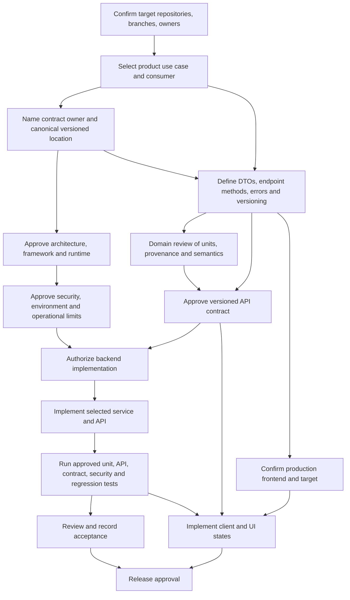

# ARC-10 Decision & Approval Register

**Purpose:** Consolidate open ARC-10 decisions and approval evidence from four planning reports. This is a tracking document, not an API contract, architecture approval, or implementation authorization.

## A. Executive status

**Readiness: planning and requirements work may continue; backend/API implementation and ARC-09 production client integration remain blocked.** None of the four source reports approves an API, architecture, framework, endpoint, schema, or implementation. The reports explicitly describe themselves as an audit, planning document, proposal, or contract-design preparation. Draft endpoints and JSON shapes in the endpoint report are marked illustrative and not approved.

The four source files were available in `C:\Users\HP\Downloads`, not in this repository's tracked tree. Their paths, sizes, and SHA-256 values are recorded below. Their claims about a refreshed ARC-10 branch are reported observations from the documents, not a live remote verification performed for this register. The readiness report identifies the snapshot as `origin/arc/10-api-integration` at `19157592d389f7fbb41830379a38efc464680c94`, dated 2026-11-12, with only `README.md`; the other reports repeat this snapshot. Local/cached refs can become stale and do not establish current GitHub contents.

**No decision below is marked approved.** Role descriptions in the source reports are task-provided ownership context; they do not establish per-decision approval authority. Explicit decision records from the authorized project process are still needed.

## Source documents and evidence boundary

| Source report | Exact available path | Size (bytes) | SHA-256 | Evidentiary status |
|---|---|---:|---|---|
| ARC-10 Repository & API Readiness Report | `C:\Users\HP\Downloads\ARC10_REPOSITORY_API_READINESS_REPORT.md` | 13,998 | `495A4FD181D1C3CEFEE5FE0AB0783B8B1220F913DBC9DEA3E2C4045282D06940` | Read in full; point-in-time audit, not approval. |
| ARC-10 Implementation Plan, Task Breakdown & Test Strategy | `C:\Users\HP\Downloads\ARC10_IMPLEMENTATION_PLAN_AND_TEST_STRATEGY.md` | 15,462 | `283C7B8BBACB7C54707E4215A073D5125A16429AD8EE781A0C90E9D0B9C54FBF` | Read in full; planning only, not approval. |
| ARC-10 Backend/API Architecture Proposal | `C:\Users\HP\Downloads\ARC10_BACKEND_API_ARCHITECTURE_PROPOSAL.md` | 14,083 | `2D3DA096C91C76EBF84E35C0A175652A16A604EAE73D89E290DF48C8B93A94D4` | Read in full; proposal only, not approval. |
| ARC-10 API Endpoint Requirements and Draft Response Schemas | `C:\Users\HP\Downloads\ARC10_API_ENDPOINT_REQUIREMENTS_AND_DRAFT_SCHEMAS.md` | 14,920 | `2F25F3E2489F9D2AF87DA94BD6B4A88384F296CA397B34121015F2A83B6CB661` | Read in full; contract-design preparation, examples explicitly not approved. |

These files were not found in the repository workspace during discovery. Their download location and hashes identify the exact local inputs reviewed; they do not prove authorship, remote branch membership, owner review, or acceptance. The reports describe a refreshed branch snapshot, but no remote refresh was performed for this task. The latest directly inspected local cached ARC-10 ref previously contained only `README.md`; that cached observation is not current remote evidence.

The readiness report identifies the NASA Exoplanet Archive TAP adapter as a bounded external provider adapter, not a general project-owned HTTP backend API. This is the report's finding, not an independent live verification in this register.

## B. Decision register

Statuses: **NOT STARTED** means no decision record was found; **DRAFT** means options or requirements are described but not approved; **AWAITING OWNER CONFIRMATION** means an explicit owner decision is needed; **AWAITING REVIEW** means a proposal needs designated review; **BLOCKED** means dependent implementation must not begin. No status below means approval.

| ID | Decision topic | Current evidence / documented options | Decision required | Preparation role supported by sources | Required reviewer/approver role supported by sources | Status | Evidence to close | Work unlocked after explicit approval |
|---|---|---|---|---|---|---|---|---|
| D-01 | Production backend repository and branch | The reports say the refreshed ARC-10 snapshot had only `README.md`; no production service target was identified. | Name the authoritative backend repository, branch, and integration target. | ARC-10 co-owners Sonjoy and Rafi prepare/coordinate. | Project/engineering owner role is mentioned; individual authority/process remains to confirm. | AWAITING OWNER CONFIRMATION | Written target and branch decision, plus current accessible repository evidence. | Repository-specific implementation planning. |
| D-02 | Production frontend repository and branch | No production frontend target was identified. `arc09-ui-prototype/` is described as a synthetic visual reference, not the production app. | Identify frontend repository, branch, framework/build stack, and owner. | ARC-09/frontend coordination; exact target owner not assigned by these reports. | Product/frontend owner to be identified; no approval record found. | AWAITING OWNER CONFIRMATION | Written target/stack decision and current repository evidence. | ARC-09 client work against the approved target. |
| D-03 | First API use case | Process health/status, dataset validation/quality, and dashboard summary are candidates; none is selected. | Select one product use case and consumer. | ARC-10 co-owners prepare options; product authority decides. | Project/product authority is named generically, not as a confirmed individual. | AWAITING OWNER CONFIRMATION | Recorded scope decision naming consumer, goal, and excluded scope. | Focused requirements and contract drafting. |
| D-04 | Contract owner and source of record | No authoritative API contract owner or versioned location was identified. | Name contract owner, canonical repository/document, versioning and change-review process. | ARC-10 co-owners prepare the contract process. | Project technical process/authority to confirm; no per-decision approver documented. | AWAITING OWNER CONFIRMATION | Owner designation and approved canonical contract location/process. | Contract authoring with traceable ownership. |
| D-05 | Framework and runtime | FastAPI, Flask, and Django REST Framework are comparison candidates only; no framework/runtime is selected. A modular monolith is proposed conditionally. | Select framework, runtime, supported versions, dependency and deployment policy. | ARC-10 co-owners prepare evaluation. | Architecture owner/technical lead; source context names Yousuf for technical direction, but not a decision-specific approval record. | AWAITING REVIEW | Recorded architecture decision with rationale and environment constraints. | Backend foundation and test harness. |
| D-06 | Endpoint paths and HTTP methods | `/example-health`, `/example-dataset-validation`, and `/example-dashboard-summary` are placeholders, explicitly illustrative. | Define approved operations, paths, methods, consumers, and scope. | ARC-10 co-owners / contract preparer. | Contract owner and project process to identify. | BLOCKED | Versioned contract with approved operation definitions. | Route and client implementation for selected operations. |
| D-07 | Request/response DTOs and versioning | Draft shapes contain `TBD` placeholders. Dashboard summary example is not a production schema; public field names/types are undefined. | Approve field names, types, required/optional/null semantics, unknown-field policy, compatibility and versioning. | ARC-10 co-owners prepare drafts. | Contract owner; domain reviewer for scientific fields. | BLOCKED | Approved schema/OpenAPI or equivalent plus examples and compatibility policy. | Runtime validation, serialization, and client mapping. |
| D-08 | Error/status conventions | Example error envelope and HTTP statuses are proposals only; mappings for validation, domain, empty, access, upstream, and internal errors are undecided. | Define status codes, stable error codes/body, valid-empty semantics, redaction, and mapping from engine errors. | ARC-10 co-owners prepare options. | Contract owner and security/platform review where relevant; authority not assigned per topic. | BLOCKED | Approved error contract and success/empty/failure examples. | Error normalization and consistent client states. |
| D-09 | Scientific semantics and provenance | Reports require explicit quantity, units, reference frame, timestamp meaning/timezone, precision, nullability, uncertainty, provenance, source/model version, and measured/simulated/estimated/predicted/assumed status. ARC-05 SI/ECI is reference evidence only in `origin/main`, not an approved API mapping. | For selected fields, define semantics, units, frames, transformations, uncertainty, provenance, precision, timestamps, nullability, and non-finite policy. | Requirements preparer coordinates relevant ARC/domain input. | Relevant scientific/domain owner; exact approver must be identified per selected data. | BLOCKED when science fields are in scope | Field-level data dictionary and domain review record tied to contract version. | Safe engine serialization and visualization mapping. |
| D-10 | Authentication and authorization | No policy or implementation found; auth requirements are explicitly TBD. | Define identity, access boundaries, authorization, browser/session behavior, and unauthenticated responses. | ARC-10 co-owners gather requirements. | Security/platform owner to identify; no individual approver confirmed. | AWAITING OWNER CONFIRMATION | Approved security/access policy and testable scenarios. | Protected endpoint implementation. |
| D-11 | CORS, secrets, and environment configuration | These are listed as TBD; no provider, base URL strategy, or secret-management mechanism is selected. | Define allowed origins if needed, configuration names/locations, secret handling, and environment separation. | ARC-10 co-owners document requirements. | Security/platform/architecture roles to identify. | AWAITING REVIEW | Approved deployment/configuration guidance with no credentials in source. | Safe environment wiring and browser connectivity. |
| D-12 | Payload, compute, timeout, cancellation, retry and rate limits | Reports identify body/record/array bounds, compute budgets, timeouts, cancellation, retries, pagination, and long-running policy as undecided. | Set workload-specific limits and failure behavior for selected use case. | ARC-10 co-owners prepare workload evidence. | Technical/platform owner to identify; relevant engine owner consulted. | AWAITING OWNER CONFIRMATION | Approved limits, operational assumptions, and test thresholds. | Bounded request handling and robustness tests. |
| D-13 | Persistence, queues, background execution | No database, queue, cache, or persistence requirement is evidenced. Background work is future-only if approved workload exceeds request budgets. | Decide only if selected use case requires durable state or asynchronous processing; otherwise record no such dependency. | Use-case preparer supplies evidence. | Product/architecture/platform decision process; no specific approver assigned. | NOT STARTED | Use-case evidence and explicit architecture decision. | Add only justified infrastructure, if approved. |
| D-14 | Cross-ARC engine integration | ARC-08 core/data/ML are described in inspected ARC-08 checkout; ARC-05 simulation and optimization appear only in `origin/main` in the reports and are not in the refreshed ARC-10 tree. | Select permitted engine operations and establish source branch/integration path, domain boundaries, and compute constraints. | ARC-10 co-owners coordinate with relevant ARC owners. | Relevant ARC/domain owners and project process; names/authority per module not established here. | AWAITING OWNER CONFIRMATION | Approved module/source refs, use case, domain review, and mapping tests. | Service-to-engine integration without duplicating engine code. |
| D-15 | Test and acceptance criteria | Unit, API, integration, contract, security/resource, provenance, and frontend-state tests are proposed. No API tests or actual acceptance matrix/results are reported for ARC-10. | Define required test environments, commands, fixtures, thresholds, reviewers, and release acceptance evidence. | Rafi's testing responsibility is stated as task context; coordinate with Sonjoy. | Amran is identified as reviewer in task context; acceptance authority/process still must be confirmed. | DRAFT | Approved acceptance matrix and environment instructions; later actual results. | Implementation verification and review. |
| D-16 | Review, release, and implementation authorization | The reports disclaim approval and authorization. Role context names Amran as reviewer and Yousuf for technical direction/contract review/final review; this does not prove approval or decision authority. | Record reviewer, decision authority, required review artifacts, release gate, and explicit authorization to implement/release. | ARC-10 co-owners assemble evidence. | Amran review and Yousuf technical/final-review roles are stated as context; formal approval path and authorized approver must be confirmed. | AWAITING OWNER CONFIRMATION | Written authorization and recorded review/acceptance under project process. | Implementation/release only within approved scope. |

## C. ARC-09 visualization decision matrix

The endpoint report treats prototype values and relationships as synthetic/conceptual. No production field mapping is approved. The request's Loading, Success, Empty, and Error states are requirements to resolve; success/empty/error semantics depend on the eventual contract.

| UI group | Unresolved data semantics and fields | Source, units, freshness, provenance | Approval needed before integration |
|---|---|---|---|
| Metric cards | Select metrics; define meaning/label, type, nullability, aggregation window, precision, and valid-empty behavior. Do not reuse prototype labels as API identifiers by assumption. | Per-metric source, unit or explicit unitless meaning, freshness/as-of semantics, and provenance unknown. | Product selects metrics; contract owner defines fields; domain owner reviews scientific meaning; frontend target confirmed. |
| Resource cards | Define resource identity, amount, unit, denominator, percentage meaning, limits/reference values, and missing-value behavior. | Source, unit, denominator, freshness, and provenance unknown. | Product and domain/contract owners approve definitions; no synthetic percentage is production data. |
| Recent activity | Define event identity, status vocabulary, ordering, timestamp/timezone, pagination/filtering, retention, and empty/partial behavior. | Event source, timestamp meaning/timezone, freshness, and provenance unknown. | Product/use-case and contract owners approve event model and access/retention policy. |
| Line chart | Define x/y meaning, units, series identity/order, sampling/aggregation, gaps, uncertainty, and valid-empty behavior. | Source, timestamp semantics, units, freshness, and provenance unknown. | Domain owner and contract owner approve each plotted series and aggregation. |
| Grouped bar chart | Define category/series, units, comparability, ordering, aggregation, and treatment of missing groups. | Source, unit, reference period, and provenance unknown. Freshness: Not defined; confirm if applicable. | Product/domain owners establish comparability; contract owner specifies data representation. |
| Scatter plot | Define axes/units, paired-observation meaning, point identity, uncertainty, filtering, and invalid-pair handling. | Source, pairing semantics, time, and provenance unknown. Freshness: Not defined; confirm if applicable. | Domain owner validates interpretation; product/contract owners approve scope and fields. |
| Relationship graph | Product need itself is unconfirmed; if needed, define stable entity/edge IDs, edge meaning/direction/cardinality, scale, permissions, and missing relationships. | Source, freshness, provenance, and authorization scope unknown. | Explicit product scope and contract/security approval required before treating the conceptual graph as a requirement. |

## D. Candidate first-use-case comparison

No option is selected. “Candidate” denotes discussion only, not a recommended or approved winner.

| Candidate | Evidence in the reports | Main unresolved decisions | Status |
|---|---|---|---|
| Process health/status | No HTTP health route found; could be small if process-only. | Consumer; liveness vs readiness meaning; dependency probes; version/timestamp; security and failure semantics. | Candidate only; NOT APPROVED. |
| Dataset validation/quality | ARC-08 checkout reportedly has `DataSchema`, `validate_dataset()`, and `analyze_quality()`; these are mechanical data checks. | Input schema, size/privacy/retention, stable issue codes, empty input, output contract, branch availability, and explicit boundary from scientific eligibility. | Candidate only; NOT APPROVED. |
| Dashboard summary | ARC-09 prototype has synthetic/conceptual dashboard cards; no authoritative source or aggregation. | Metric selection/definitions, source, units, aggregation, freshness, nullability, provenance, frontend target, and empty/error states. | Proposed candidate; PENDING APPROVAL. |

## E. Approval and evidence tracker

| Area | Current status | Approval evidence found in the four reports? | Closure record required |
|---|---|---|---|
| Repository/branch and frontend target | AWAITING OWNER CONFIRMATION | No. Reports describe targets as unresolved. | Explicit repository, branch, stack, owner, and source-of-truth record. |
| First use case | AWAITING OWNER CONFIRMATION | No. Three candidates remain unselected. | Product decision naming consumer, operation, scope, and exclusions. |
| Architecture/framework | AWAITING REVIEW | No. Modular monolith and frameworks are proposals/options. | Approved architecture decision with rationale, runtime, and deployment boundary. |
| API contract and versioning | BLOCKED | No. Draft placeholders only; no approved contract. | Versioned authoritative contract, owner, review and compatibility process. |
| Scientific data definitions | BLOCKED if selected fields require them | No. Requirements are enumerated, not field decisions. | Field-level data dictionary/domain review linked to contract. |
| Security and operations | AWAITING OWNER CONFIRMATION | No. Explicitly TBD / requires approval. | Security/platform decisions and operational thresholds. |
| Test/release acceptance | DRAFT | No. Proposed test matrix/DoD only. | Approved test instructions, acceptance criteria, reviewer and recorded outcome. |
| Implementation/release authorization | BLOCKED | No. All four documents disclaim authorization. | Explicit authorization from the established decision authority, plus review evidence. |

**APPROVED — none.** A role being named in planning context is not approval evidence. A draft schema, illustrative endpoint, fetched-branch description, or test proposal must not be promoted to an approved contract.

## F. Critical path

Dependencies are conditional: scientific review applies to scientific fields; persistence/queues apply only if justified; ARC-05/06 integration requires branch/module availability and domain/workload approval. The diagram is a proposed sequencing aid, not an approved project workflow.

## G. Final readiness verdict

**Planning readiness: PARTIAL. Implementation readiness: BLOCKED.** The reports support continuing requirements clarification, comparing use cases, and preparing approval-ready contract/architecture options. They do not support implementing a backend route, selecting a framework, connecting ARC-09 to production, or treating any illustrative JSON as a contract.

Before implementation, obtain explicit decisions for target repositories/branches, selected use case, contract owner and canonical contract location, framework/runtime, endpoint and DTO semantics, errors, relevant scientific definitions, security/environment policy, workload limits, test/acceptance process, and implementation authorization. Confirm that the reported ARC-10 branch snapshot is still current and obtain the source reports in an authoritative shared/repository location if they are to serve as project records.

### Immediate safe activities

- Continue documenting requirements and decision options without assigning them approved status.
- Request owner decisions and domain definitions through the project's approved coordination process.
- Preserve the distinction between the synthetic ARC-09 prototype and production data.
- Revalidate repository/branch contents when remote access is authorized and available.

### Blocked activities

- Production endpoint/client implementation or speculative network calls.
- Publishing draft endpoints/schemas as API documentation.
- Choosing a framework, authentication model, persistence system, queue, or deployment provider without approval.
- Mapping synthetic prototype values to production fields or asserting scientific meaning.
- Claiming acceptance, release readiness, or project approval from these planning reports.
