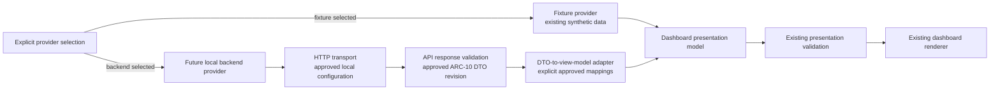

# ARC-09 Backend Transport Design — 2026-11-15

## 1. Executive summary

The ARC-09 prototype already has an asynchronous frontend provider seam: `getData()` returns a Promise, and the application validates the resulting presentation model before rendering. Its selected implementation is a local synthetic fixture provider with no I/O. This is a useful boundary for a future local backend provider, but it is not an HTTP client, API contract, DTO validator, or DTO-to-view-model adapter.

This document proposes a contract-independent separation for that future work. It does not specify routes, methods, wire fields, response formats, authentication, retries, or backend behavior. The expected ARC-10 v0.3 contract artifacts were not found in the inspected checkout. Until ARC-10 provides authoritative, versioned artifacts and the required decisions are confirmed, backend transport implementation remains **BLOCKED**. The Project Owner authorization and ownership boundaries described in the task are treated as user-reported context, not independently verified repository approval.

## 2. Current provider architecture

### Verified repository behavior

- `arc09-ui-prototype/data.js` defines the frozen synthetic fixture: overview cards, resource cards, trend series, grouped comparison series, scatter points, a conceptual relationship graph, and activity rows. Its header and README identify the values as synthetic/conceptual, not NASA or mission data.
- `arc09-ui-prototype/data-provider.js:8–22, 30–45, 47–64, 68–73` defines the default fixture, registry registration and selection, async selected-provider retrieval, and the dashboard-facing provider facade. The fixture resolves the existing data and performs no I/O.
- `arc09-ui-prototype/index.html:165–169` loads `data.js`, `data-provider.js`, `charts.js`, `data-validation.js`, then `app.js`.
- `arc09-ui-prototype/app.js:264–285` enters loading state, requires the provider, awaits `getData()`, and checks the result with `hasValidPrototypeData()` before rendering. Startup rejection is routed to cleanup by `app.js:331–336`.
- `arc09-ui-prototype/data-validation.js:1–26` checks the prototype presentation shape and primitive types. It is not an API DTO or authoritative schema validator; its array checks permit empty arrays.
- `arc09-ui-prototype/app.js:296–328` sends the validated presentation model to cards, activity filtering, charts, and accessible chart tables. The renderers do not consume transport responses.
- `arc09-ui-prototype/README.md`, “Prototype data provider,” documents the Promise-returning seam, fixture default, lack of I/O/API provider, separate presentation validation, and no silent fallback.

### Historical architecture snapshot and current limitation

**Historical snapshot from the original design review:** provider choice was represented by the single `window.arc09PrototypeProvider` object loaded by the page, and no provider registry or runtime selector was present in that reviewed source state. That observation is retained as historical context and is superseded by the current-source reconciliation below.

**Current source, rechecked 2026-11-15:** `arc09-ui-prototype/data-provider.js:30–45, 47–64, 68–73` exposes `window.arc09PrototypeProviderRegistry` with explicit `register(id, provider)` and `select(id)` operations. The `fixture` provider is registered and selected by default (`:8–22`). Providers expose asynchronous `getData()`; the registry captures the validated method at registration, and the dashboard-facing `window.arc09PrototypeProvider.getData()` retrieves data from the selected provider. Selecting an unknown or not-yet-registered provider does not cause fixture fallback; retrieval rejects when that selected provider is unavailable, and provider rejection propagates. The selection seam is programmatic; the inspected page does not add a user-facing or environment-based provider selector.

The current fixture provider resolves the existing synthetic presentation model without network I/O (`data-provider.js:12–22`). `arc09-ui-prototype/app.js:276–285` awaits provider data and validates it with the frontend presentation validator before rendering (`:296–328`). The repository still has no API-backed provider, HTTP transport, ARC-10 DTO validator, or DTO-to-view-model adapter. Any future transport, validation, and mapping remain pending authoritative ARC-10 artifacts and project decisions. A selected future provider must fail visibly when unavailable or rejecting and must never silently substitute fixture data.

## 3. Proposed transport architecture

The boundary should preserve one stable frontend-facing provider contract: a selected provider asynchronously returns the complete dashboard presentation model currently consumed by `app.js`. The fixture provider remains available for the existing synthetic path. A future backend provider would coordinate transport, contract-specific response validation, and mapping before it resolves that same frontend-facing contract.

Responsibilities proposed for the layers:

1. **Fixture provider — existing:** return the existing synthetic presentation fixture. No network activity.
2. **HTTP transport — future:** perform only the approved local request operation, using approved configuration and transport policies. It handles request/response mechanics, not chart semantics.
3. **API response validation — future:** validate a received payload against the exact approved ARC-10 DTO/schema revision. It must not reuse the presentation validator as a substitute.
4. **DTO-to-view-model adapter — future:** map only contract-approved backend values into the existing frontend presentation model. It owns explicit mapping and presentation-specific transformations; it does not invent scientific or resource calculations.
5. **Dashboard renderer — existing:** receive the current presentation model and render it. Chart renderers should remain unaware of HTTP and backend DTO structures.

The async provider contract is the integration seam, not a claim that transport is ready. Whether the provider returns a view model directly or uses separately named internal transport/DTO/adapter modules is an implementation decision for a later authorized phase; those internal module names and files are not prescribed here.

## 4. Proposed data flow

All backend-specific stages in this diagram are **PROPOSED** and depend on ARC-10 artifacts and project decisions. The existing path is fixture provider → presentation model → presentation validation → renderer. A transport or mapping failure must reject the selected backend-provider operation and reach the existing startup failure path; no fixture fallback is implied.

## 5. Transport requirements

The classifications below separate established constraints from design proposals. “Confirmed” refers to repository evidence or task-provided context as labeled; it is not independent approval evidence.

| Requirement | Status and source | Design treatment |
|---|---|---|
| Local-only, non-production use with synthetic educational data | **USER-REPORTED AUTHORIZATION** in the task context; the prototype README confirms current fixture values are synthetic. | Keep any later transport configuration local and non-production. Do not use unapproved NASA or production data. This report does not verify formal approval records. |
| Configurable local backend base URL | **PROPOSAL.** No base URL or environment strategy is established in inspected source. | Obtain the configuration mechanism, allowed origins, and local deployment assumptions from ARC-10/Project Owner before implementation. Do not hard-code a guessed URL. |
| Explicit provider selection | **VERIFIED current source:** `data-provider.js` provides a registry with `register(id, provider)` and `select(id)`; `fixture` is selected by default. Selection is programmatic, and no API-backed provider or user-facing/environment-based selector is present. Selected-provider retrieval has no silent fixture fallback. | **PROPOSAL:** retain explicit selection when a future provider is added. The authorized configuration/build mechanism, if needed, remains to be decided; do not infer a selector or backend provider from this registry. |
| HTTP status handling | **GAP:** no HTTP status contract or transport exists. | **PROPOSAL:** classify transport outcome using ARC-10-approved status semantics; do not infer success/error meaning from status numbers alone. Preserve response details only as needed for safe validation and generic UI handling. |
| Network failure handling | **GAP:** current provider has no network behavior. | **PROPOSAL:** distinguish inability to complete transport from an HTTP response and from a received payload that fails DTO validation. Expose a safe normalized error to the UI. |
| Timeout and cancellation | **GAP:** no request lifecycle policy is established. | **PROPOSAL:** agree bounded request duration, cancellation source/lifecycle, and cleanup behavior before implementing requests. Do not select numerical limits without owner/service evidence. |
| JSON parsing failures | **GAP:** no JSON transport/parsing exists. | **PROPOSAL:** treat malformed/unparseable response bytes as a transport/representation failure distinct from a well-formed JSON value that fails DTO validation. Exact classification and UX require ARC-10 agreement. |
| Safe error normalization | **Confirmed boundary:** the current startup path reports a generic failure and should not expose backend internals. Exact future error categories are not established. | **PROPOSAL:** normalize to a small frontend-owned error category/message boundary; avoid rendering raw server bodies, stack traces, internal URLs, or sensitive details. Do not invent a backend error envelope. |
| Separation of transport and DTO errors | **PROPOSAL**, consistent with separate responsibilities; no API DTO validator exists. | Keep network/HTTP/parse failures distinct from schema/DTO validation failures internally and in tests. Presentation validation remains a later, separate check. |
| No silent fixture fallback | **VERIFIED** in `data-provider.js`/README for the current explicit provider seam. | Preserve this rule for future provider selection. A selected backend failure must remain visible as a failure; it must never display fixture results as if they came from the backend. |
| No frontend production secrets | **PROPOSAL / security requirement**; no backend credentials are present in this prototype. | Do not embed secrets or privileged credentials in browser-delivered source. Any future access mechanism must be explicitly approved by the responsible security/architecture authority. |
| Retry behavior | **GAP:** no retry semantics are established. | Do not retry automatically or manually until ARC-10/Project Owner define idempotency, retryable outcomes, limits, and user-visible behavior. No retry behavior is proposed as a default here. |
| Synthetic data meaning | **VERIFIED:** fixtures are labeled synthetic/conceptual; README disclaims actual resources or mission results. | Keep fixture mode clearly identified. Do not map fixture labels or values onto real backend fields by resemblance alone. |

## 6. Error-handling design principles

These are frontend design principles, not an API error contract:

- Preserve the distinction between request/transport failure, HTTP response failure, JSON parsing failure, DTO/schema validation failure, mapping failure, presentation-model validation failure, and renderer failure.
- Convert low-level failures into safe frontend-owned status categories and user-appropriate messages. Raw backend bodies and internal diagnostics must not be shown directly in dashboard content.
- Keep diagnostic detail suitable for local development without adding secrets, personal paths, or unredacted server internals to user-facing output or durable logs. Logging policy itself remains to be approved.
- Keep current loading and startup cleanup behavior. A provider rejection should not leave the dashboard marked busy or show partial fixture content as backend data.
- Do not add retry, stale-data substitution, caching, or fallback policy until their semantics and security implications are agreed.
- Treat chart-specific empty-state behavior as presentation behavior only. Whether an empty backend result is valid, an error, or an absent scope is an ARC-10 contract/product decision.

## 7. DTO validation and mapping boundary

The current `hasValidPrototypeData()` check answers whether values have the shape expected by the dashboard. It does not establish that an API response is valid, semantically correct, scientifically meaningful, or authorized. Future processing should remain ordered and separate:

1. Transport receives a response under an approved request definition.
2. JSON decoding establishes only whether the response can be parsed as JSON.
3. An API validator checks the decoded value against the authoritative ARC-10 DTO/schema revision, including approved requiredness, nullability, types, and compatibility policy.
4. A mapping adapter converts validated DTO values to the dashboard’s existing presentation model. Every field and transformation must have an explicit reviewed mapping; no units, aggregation, timestamp interpretation, provenance, or scientific meaning may be inferred from frontend fixture properties.
5. Existing presentation validation checks that the adapter output meets renderer expectations.
6. Existing cards, activity, tables, and charts render the presentation model without learning backend DTO details.

Unknown-field handling, schema evolution, timestamp and number rules, invalid-field diagnostics, and whether validation is performed in browser code or generated from shared schema material are **PENDING ARC-10/Project Owner decisions**. No DTO field names or schemas are defined by this design.

## 8. ARC-10 dependencies and missing decisions

The local checkout did not contain these expected documents at the time of this audit:

- `docs/ARC10_DTO_SPECIFICATION_V0.3.md` — **NOT FOUND**.
- `docs/ARC10_API_CONTRACT_V0.3.md` — **NOT FOUND**.
- `docs/ARC10_V0.3_OPEN_DECISIONS.md` — **NOT FOUND**.
- `docs/ARC10_DASHBOARD_API_SCOPE_DECISION_PACKAGE.md` — **NOT FOUND**; no alternate matching dashboard-scope artifact was found under `docs/`.
- `docs/ARC10_ARC09_COORDINATION_CHECKLIST.md` — **NOT FOUND**.

`docs/ARC10_DECISION_APPROVAL_REGISTER.md` and its handover copy exist, but they are approval-register evidence and do not substitute for the missing v0.3 API contract or DTO artifacts. A sixth artifact mentioned in earlier handoff context was not identified by filename and is **NOT VERIFIED**. User-pasted material is not treated as a repository file or independently verified source.

Before a transport client can be implemented, ARC-10 and the designated authorities must supply or confirm:

1. Canonical repository paths, exact revisions/hashes, versions, and approval/draft status for the relevant contract, DTO, open-decision, dashboard-scope, and coordination materials.
2. The bounded initial operation(s), endpoint path(s), HTTP method(s), request requirements, response DTOs, content/serialization rules, and authoritative examples.
3. DTO field names, types, requiredness, nullability, unknown-field behavior, identifiers, timestamps, units, ordering, aggregation, provenance, and compatibility/versioning rules.
4. HTTP status meanings, error payload definitions if any, malformed/empty/unsupported-input semantics, and which errors may be returned to the frontend.
5. Whether the initial backend scope supplies dashboard data at all; if so, the approved scope for overview/resource/activity and each visualization, with semantic and upstream data ownership.
6. Authentication/authorization, CORS/origin policy, local configuration, secret handling, privacy/retention, logging/redaction, and non-production service location.
7. Timeout, cancellation, retry, cache, concurrency, payload/resource limits, and operational expectations.
8. The ARC-08 evaluator identity/revision and approved adapter/index/provenance boundary where its output is relevant. Do not create resource calculations or scientific claims in ARC-09.
9. Contract ownership, technical contact, test environment, representative verified responses, integration-test responsibilities, acceptance criteria, and required Project Owner approval.

All route, method, DTO, authentication, response, and error details remain **UNKNOWN / NOT PROVIDED** by this checkout. No API connectivity or backend implementation is claimed.

## 9. Security and local-only boundaries

- The reported authorization is bounded to local-only, non-production implementation with synthetic educational data. It is recorded here as user-reported context, not as independently verified approval evidence.
- Do not connect to production, use production credentials, embed secrets in frontend code, or introduce unapproved NASA data.
- Do not treat browser-side DTO validation as an authorization or security boundary; server-side ownership and validation requirements belong in the approved ARC-10 contract/security decisions.
- Do not expose raw backend responses or internal diagnostics in the user interface.
- Do not claim scientific validation, mission safety, physical correctness, NASA authenticity, or resource calculations from structural validation or visualization rendering.
- No production deployment, production readiness, or contract approval is implied.

## 10. Dashboard compatibility, implementation phases, and acceptance criteria

The future adapter should preserve the current consumer shapes unless a separately approved frontend change is made. These are **frontend presentation expectations**, not backend DTO declarations:

| Existing consumer | Current presentation input | Compatibility requirement for a future adapter |
|---|---|---|
| Overview cards | `overview`: label, value, detail, icon, tone (`app.js` card rendering; `data-validation.js:15`) | Supply values only where an approved backend mapping and meaning exist; keep display labels/style properties frontend-owned where appropriate. Do not assume these properties are wire fields. |
| Resource cards | `resources`: label, finite numeric value, unit, detail (`data-validation.js:16`) | Do not calculate or reinterpret resource values. ARC-08/upstream ownership and units/semantics must be explicit before mapping. |
| Activity list | `activity`: title, action, status, time (`data-validation.js:23`; `app.js` activity rendering/filter) | Define source, ordering, timestamp semantics, and filtering scope before mapping. Do not assume activity data is available from the initial API. |
| Line chart | `trend`: finite numeric `step` and `value` (`app.js:300,304`) | Confirm whether the backend supplies a series, ordering/time semantics, units, and empty behavior; map explicitly to the existing model. |
| Grouped-bar chart | `comparison`: category, finite `seriesA` and `seriesB` (`app.js:301,305`) | Confirm category and series meanings, units, order, aggregation, and whether two series are in scope. These names are fixture/view-model properties only. |
| Scatter chart | `scatter`: finite numeric `x` and `y` (`app.js:302,306`) | Confirm dimensions, units, ranges, record correspondence, and domain semantics before mapping. Existing unitless values do not establish backend meanings. |
| Conceptual relationship graph | `relationshipGraph`: label, nodes with id/label, edges with from/to/label (`data-validation.js:20–22`; `app.js:303,307–315`) | Confirm whether real graph data belongs in scope, node/edge identity and referential rules, semantics, and accessibility/table representation. Current graph is illustrative only. |

Proposed implementation phases (each is a future authorization gate):

1. **Contract intake and decision record — BLOCKED pending ARC-10.** Record canonical artifacts/revisions, operation scope, DTO schemas, semantics, security, and owner approvals. Acceptance: every required dependency above has an evidence reference or is explicitly excluded by the authorized scope.
2. **Mapping specification — PROPOSAL.** ARC-09 drafts a field-by-field DTO-to-view-model worksheet with source, type, nullability, unit, time/order, transformation, and consumer; ARC-10 and relevant domain owners confirm backend meaning. Acceptance: no guessed or unmapped required renderer input; every transformation is reviewed.
3. **Transport/provider implementation — BLOCKED pending contract and authorization.** Implement only the approved local operations behind an explicitly selected provider; keep fixture provider independently selectable. Acceptance: provider errors reject without mock fallback; configuration and error handling match the approved policy; no production target or secret is embedded.
4. **DTO validation and adapter — BLOCKED pending authoritative DTOs.** Validate the approved response shape separately, map it explicitly, then run presentation validation. Acceptance: transport, DTO, mapping, and presentation failures are distinguishable and do not render partial/fixture values as backend data.
5. **Integration verification — BLOCKED pending local service and test agreement.** Test success, malformed JSON, HTTP/network failures, invalid DTOs, missing required data, valid empty results, mapping failures, timeout/cancellation, and any approved access behavior. Acceptance: deterministic evidence ties each test to the exact contract revision and local service; existing fixture regression tests remain intact.

## 11. Final status

**Current status: provider seam READY; backend transport and DTO mapping BLOCKED.** The existing asynchronous interface can host a future provider that returns the current presentation model, while keeping transport and backend structures outside renderers. However, there is no repository-verified ARC-10 v0.3 contract package, endpoint, DTO, response/error semantics, local test target, or approved mapping in this checkout. Contract-independent documentation and frontend-consumer mapping preparation can proceed; API calls and backend DTO implementation must wait for those artifacts and decisions.

**Historical authoring note:** no application code, test, provider, transport, endpoint, DTO, backend, or server was created or modified as part of preparing the original design document. The 2026-11-15 reconciliation updates documentation only and does not add or change application behavior. No tests or browser checks were run for this documentation update.
